<h1 align="center">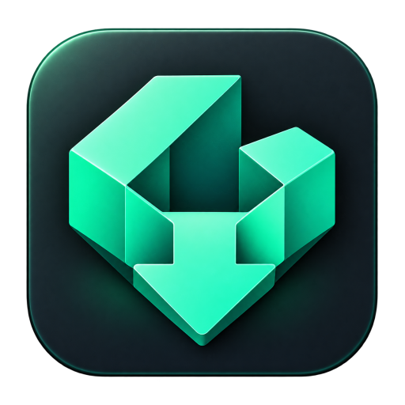 치지직 다운로더 (ChzzkDownloader)</h1>

  
  
  

  
  
  
  

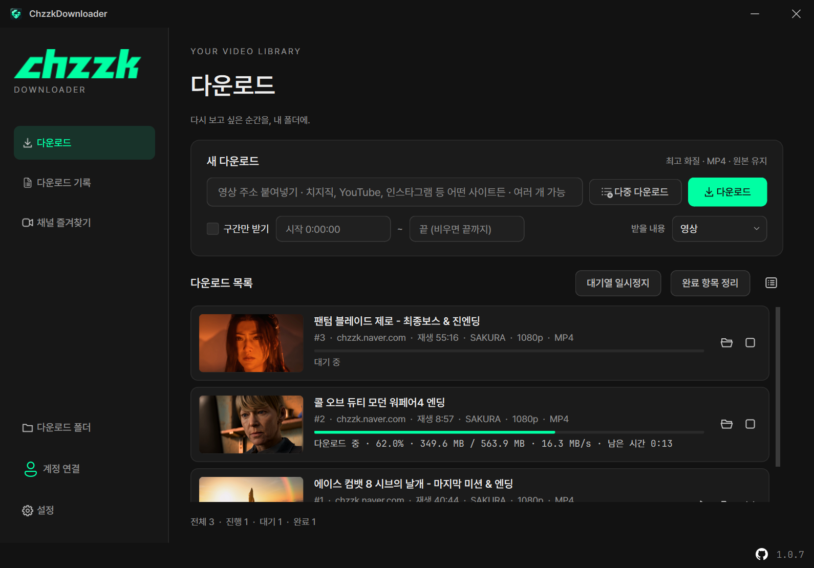

  
  

---

  
  
  
  
  
  
  
  

---

## 📌 소개

치지직 VOD·클립, YouTube, 인스타그램, TVer 등 여러 사이트의 영상 주소를 분석해 MP4로 저장하는 Windows 프로그램입니다.
주소를 붙여넣거나, 즐겨찾는 치지직 채널에서 영상을 골라 받습니다.
평소 브라우저에서 내보낸 쿠키로 치지직 계정을 연결하면 팔로잉 채널을 즐겨찾기로 가져오고, 시청 권한이 있는 19세 영상도 받을 수 있습니다.
TVer는 일본 VPN에 연결한 상태에서 다운로드해야 합니다.

**1.0.7 (2026-11-02)**에 중단된 다운로드 이어받기, 라이브 방송 녹화, 치지직 다시보기 채팅 저장, 구간 다운로드를 추가했습니다. 파일 이름·채널별 폴더·속도 제한을 설정하고, 즐겨찾기 채널의 새 영상 알림과 자동 다운로드를 사용할 수 있습니다. 채널 화면에는 보기·정렬과 영상·채팅 저장 배지를 추가하고, 중복 확인·저장 공간 확인·실패 안내·썸네일 캐시 관리도 개선했습니다. 자세한 내용은 [1.0.7 변경 기록](CHANGELOG.md#107---2026-11-02)에서 확인하세요.

## 💻 시스템 요구 사항

- Windows 10 / 11 (x64)
- 인터넷 연결

## ✨ 주요 기능

- **다운로드**: 주소 붙여넣기·끌어놓기, ‘다중 다운로드’ 창에서 여러 주소를 한 줄씩 추가. 동시 영상 최대 4개·영상당 조각 최대 16개
- **저장 설정**: 저장 위치·화질·인코딩, 파일 이름 규칙(제목 / 날짜 + 제목 / 채널 + 제목 / 날짜 + 채널 + 제목), 채널별 폴더를 선택하고 다음 실행에도 유지. 날짜는 영상 게시일 기준
- **속도 제한**: 영상 한 개당 1·2·5·10·20·50 MB/s 또는 제한 없음을 선택. 여러 영상을 받으면 합계는 동시 영상 수만큼 늘어날 수 있음
- **이어받기·자동 재시도**: 취소·실패한 영상의 받은 부분을 보관하고 재시도·같은 주소 추가·재실행 후 대기열 재개 시 이어받기. 일시적인 연결 오류는 두 번까지 자동 재시도
- **라이브 녹화**: 라이브 주소를 넣어 녹화하고 중지·연결 끊김 시 지금까지 받은 부분을 MP4로 저장. 녹화 크기·경과 시간·남은 공간으로 녹화 가능한 시간 표시
- **구간만 받기**: 주소를 추가하기 전에 시작·끝 시각을 지정해 필요한 구간만 저장. 끝을 비우면 영상 끝까지, 재인코딩 없이 잘라 몇 초 차이가 날 수 있음
- **치지직 다시보기 채팅 저장**: ‘받을 내용’에서 채팅만 또는 영상 + 채팅을 선택해 오프라인 HTML로 저장. 검색·사용자별 채팅·구독·후원·가림 상태를 확인하고, 닉네임을 바꿔도 같은 사용자 ID로 모아 보기
- **완료 항목**: 이번 실행에서 완료한 영상은 다운로드 목록에서 재생하거나 더블클릭. ‘완료 항목 정리’로 숨겨도 기록과 영상은 유지
- **대기 목록 복원·삭제**: 취소·대기·종료 중단 작업은 다시 실행하면 대기 상태로 복원. ‘대기열 계속’으로 시작하며, 필요 없는 대기 항목은 다운로드 목록에서 우클릭 → ‘목록에서 삭제’로 복원 없이 제거
- **중복 다운로드 확인**: 주소 형태가 달라도 같은 영상이면 다시 다운로드할지 확인. 기록 화면의 최근 500개 밖에 있는 영상도 기억하며, 대기·진행 중인 영상은 중복 추가하지 않음
- **채널 즐겨찾기**: 채널명이나 주소로 검색해 저장하고, 카드를 드래그해 순서 변경. 전체 영상·다시보기·업로드·클립과 최신순·인기순을 골라 영상 선택. 연령 제한은 19세 배지로 구분
- **영상·채팅 저장 배지**: 채널 카드에 ‘받음’·‘채팅 받음’·‘영상·채팅 받음’을 구분해 표시. ‘받지 않은 영상만 선택’과 ‘선택한 영상 채팅 저장’ 제공
- **즐겨찾기 새 영상 확인**: 설정에서 켜면 30분마다 확인해 ‘새 영상 N’ 배지와 트레이 알림 표시. 채널별 ‘새 영상 자동 다운로드’를 켜면 이미 받은 영상은 건너뛰고 새 영상만 대기열에 추가
- **치지직 계정 연결**: 평소 브라우저에서 내보낸 cookies.txt로 연결. 아이디·비밀번호 입력 없이 로그인 쿠키만 Windows 암호화로 보관하며 다시 실행해도 유지. 본인·성인 인증된 계정의 시청 권한으로 19세 영상 다운로드
- **팔로잉 자동 추가**: 저장된 계정의 팔로잉 채널을 로그인·앱 시작 시 즐겨찾기에 자동 추가. 기존 채널과 순서를 유지하고 중복 없이 병합하며, 설정에서 다시 가져오기 가능
- **계정 프로필 전환**: 여러 계정의 쿠키를 저장하고 설정 위의 프로필 사진·계정 이름에서 전환. 계정마다 즐겨찾기와 순서를 따로 유지
- **다운로드 기록**: 완료·실패·취소 작업을 따로 모아 다시 재생·재시도. 썸네일은 다시 열어도 유지
- **실패 안내·저장 공간 확인**: 실패 원인과 다음 조치를 한국어로 안내하고 원문도 보관. 크기를 알 수 있는 영상은 다운로드 전 필요한 공간을 확인하고, 부족하면 전송 전에 안내
- **썸네일 캐시 관리**: 설정에서 캐시 사용량 확인·비우기. 시작할 때 기록에 더 이상 없는 영상의 캐시 자동 정리
- **작업 로그**: 목록 상단의 로그 버튼으로 열고 닫기. 카드 선택이나 로그 필터로 원하는 작업만 확인하며 로그를 열어도 입력창·버튼·카드가 좌우로 밀리지 않음
- **MP4 저장·변환**: 원본 유지가 기본. 필요하면 CPU 또는 NVIDIA NVENC로 H.264(AVC)·H.265(HEVC) 변환. 변환이 실패하거나 취소돼도 원본 보존. 끊긴 방송의 이어진 녹화본처럼 시작 시각이 늦은 영상은 화질 변환 없이 0초부터 시작하게 저장
- **트레이 실행**: 창을 닫아도 트레이에서 다운로드 계속, 대기열 일시정지·재개, 완료 알림
- **자동 업데이트**: GitHub 정식 릴리스의 추가·변경·수정 내역을 확인한 뒤 ‘지금 업데이트’·‘나중에’를 선택. 설치 시 SHA-256 검증 후 프로그램만 교체. 영상·기록·설정은 그대로. 설정에서 직접 확인했을 때 최신이면 안내창 표시
- **도구 업데이트**: 첫 실행에 FFmpeg·ffprobe와 yt-dlp nightly를 받고, 시작할 때마다 확인해 없거나 손상되었으면 자동으로 다시 준비. 모든 탭의 하단에서 상태·진행률을 확인하고, 완료 안내는 5초 뒤 서서히 사라짐. 설정의 ‘도구 업데이트’는 최신 도구를 다시 받지 않고 바뀌었거나 손상된 도구만 교체
- **화면과 버전 표시**: 화면 해상도와 Windows 배율에 맞춘 고정 창. 진행률·속도·버전에는 JetBrains Mono를 적용하고, 메인 창 오른쪽 아래의 흰색 GitHub 아이콘을 누르면 저장소로 이동

## 🚀 다운로드 및 실행

1. 릴리스의 `ChzzkDownloader_v107.zip` 파일을 내려받아 압축을 풀고 `ChzzkDownloader.exe`를 실행합니다.
2. 첫 실행에는 인터넷으로 필요한 영상 도구(FFmpeg·ffprobe, yt-dlp nightly)를 자동으로 받습니다. **창 하단의 상태와 진행 표시**로 준비 상황을 확인하세요. 준비가 끝나면 사이드바 맨 아래 **설정**에서 저장·다운로드, 치지직 계정, 영상 변환, 프로그램 동작, 업데이트 항목을 정합니다.
3. 어떤 사이트의 영상 주소든 붙여넣고 **다운로드**를 누릅니다. 여러 영상을 한꺼번에 추가하고 싶을 경우 **다중 다운로드** 창에 한 줄씩 넣고 **다운로드 (개수)**를 누릅니다. 입력 순서대로 목록에 추가되며 설정한 동시 영상 수만큼 시작합니다.
4. 채널 단위로 고르려면 **채널 즐겨찾기**에서 채널을 검색해 저장한 뒤 카드를 누릅니다. **전체 영상·다시보기·업로드·클립**, **최신순·인기순**을 고르고, **받지 않은 영상만 선택**으로 이미 받은 영상을 제외할 수 있습니다.
5. 다운로드가 완료된 영상은 **다운로드 목록**에서 바로 재생 가능합니다. 이전 실행의 작업·실패·취소 항목은 **다운로드 기록**에서 확인합니다.
6. 취소·대기·종료 중단 작업은 다음 실행에 대기로 복원됩니다. **대기열 계속**으로 재개하면 보관한 부분부터 이어받습니다. 실패한 작업도 **재시도**로 이어받을 수 있습니다. 필요 없는 대기 항목은 **다운로드 목록에서 우클릭 → 목록에서 삭제**를 누릅니다. 기록과 완성된 영상은 유지하며, 보관한 미완성 조각은 기록에서 해당 작업을 지울 때 정리됩니다. 이미 받은 영상은 주소 형태가 달라도 **다시 다운로드**할지 확인합니다.
7. 치지직 계정을 연결하려면 아래 **쿠키 파일 저장하기**를 따라 `chzzk.naver.com_cookies.txt`를 저장합니다. 앱의 **설정 → 치지직 계정 → 쿠키 파일 가져오기**에서 저장에 동의하고 이 파일을 선택한 뒤 **가져오고 연결**을 누릅니다. 로그인 확인 후 인증 쿠키 두 개만 암호화 저장하고 팔로잉 채널을 즐겨찾기에 추가합니다. 아이디·비밀번호 입력은 필요 없습니다.
8. 다른 계정의 쿠키를 가져오면 새 프로필로 추가하고, 같은 계정은 쿠키를 갱신합니다. **설정 위의 프로필 사진·계정 이름**을 누르면 저장된 계정을 전환하고 **치지직 채널 열기·로그아웃·새 계정 추가**를 선택할 수 있습니다. 계정이 하나여도 같은 메뉴를 표시하며, **새 계정 추가**를 누르면 **브라우저 쿠키로 치지직 계정 연결** 창이 바로 열립니다. 저장에 동의한 뒤 다른 계정의 쿠키 파일을 선택해 연결하세요. 즐겨찾기와 순서는 계정마다 따로 보관하고 재실행해도 선택한 계정을 유지합니다. 사진이 없는 계정에는 기본 아이콘을 표시합니다.

### 1.0.7의 새 기능 사용하기

- **채팅 저장**: 다운로드 화면의 **받을 내용 → 채팅만 / 영상 + 채팅**을 선택한 뒤 치지직 다시보기 주소를 넣습니다. 채널 화면에서는 **선택한 영상 채팅 저장**을 누릅니다. 저장한 HTML을 브라우저에서 열고 닉네임을 누르면 그 사용자의 채팅만 볼 수 있으며, ↗는 그 사용자의 채널을 엽니다. 검색창에 채널 주소나 ID를 붙여 넣어도 찾을 수 있습니다.
- **구간 다운로드**: **구간만 받기**를 켜고 시작·끝(예: `1:00:00` ~ `1:30:00`)을 입력한 뒤 주소를 추가합니다. 한 번 추가하면 체크가 풀립니다. 다중 주소에도 적용되며, 채널 화면에서 고른 영상에는 적용되지 않습니다. **영상 + 채팅**에서는 영상만 잘라 받고 채팅은 전체를 저장합니다.
- **라이브 녹화**: 라이브 방송 주소를 넣고 다운로드를 시작합니다. 카드의 중지 버튼을 누르면 지금까지 녹화한 부분을 저장합니다. 라이브 녹화는 동시 다운로드 수에 포함되지 않으며, 재실행 복원·이어받기 대상이 아닙니다.
- **파일 이름·폴더·속도**: **설정 → 저장 · 다운로드**에서 정합니다. 새로 추가한 작업부터 적용되며, 속도 제한은 라이브·구간 다운로드에는 적용되지 않을 수 있습니다.
- **새 영상 알림·자동 다운로드**: **설정 → 프로그램 동작 → 즐겨찾기 채널의 새 영상을 30분마다 확인**을 켭니다(기본 꺼짐). 자동으로 받을 채널은 채널 화면에서 **새 영상 자동 다운로드**도 켜세요. 처음 확인한 시점의 기존 영상은 알리거나 자동으로 받지 않습니다.
- **캐시 정리**: **설정 → 프로그램 동작 → 썸네일 캐시 → 캐시 비우기**에서 미리보기만 지울 수 있습니다. 기록과 저장 파일은 유지됩니다.

### 쿠키 파일 저장하기

1. 평소 치지직을 보는 브라우저에 [Get cookies.txt LOCALLY](https://chromewebstore.google.com/detail/get-cookiestxt-locally/cclelndahbckbenkjhflpdbgdldlbecc)를 설치합니다.
2. 치지직에 로그인한 뒤 `메인 화면 https://chzzk.naver.com/` 을 열어 둡니다.
3. **브라우저 주소창 옆에서 확장 프로그램 아이콘을 눌러** 여세요. 아래처럼 표시된 주소가 치지직인지 확인한 뒤 **왼쪽 첫 번째 Export 버튼만** 누르세요.

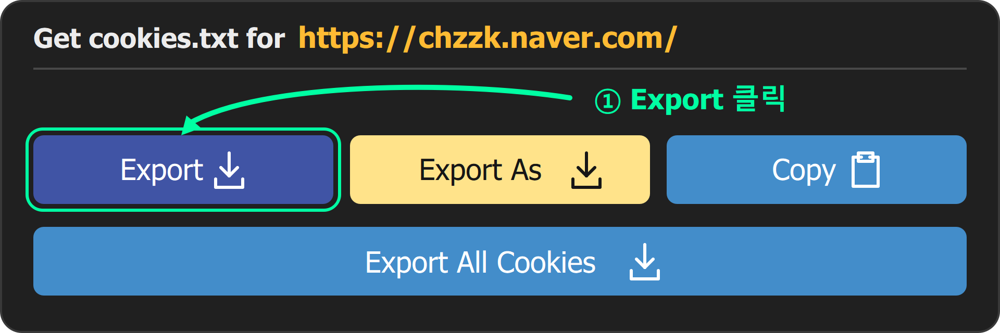

4. 쿠키 파일의 기본 저장명은 `chzzk.naver.com_cookies.txt`입니다. 다운로드 위치를 확인하고, 저장 창이 나오면 원하는 위치에 저장합니다.
5. 치지직 다운로더 앱에서 **파일 선택 → 가져오고 연결** 순서로 진행합니다. 가져오기 창에서도 같은 이미지와 순서를 확인할 수 있습니다.

## 📸 화면

아래 화면은 **1.0.7 배포 EXE**에서 캡처한 실제 화면입니다. 영상 정보는 현재 공개 목록에서 가져왔고, 다운로드·녹화·저장 배지·새 영상 알림·제한 상태와 계정 이름·사진은 소개용 예시입니다. 실제 다운로드·녹화·계정 인증 결과를 뜻하지 않습니다.

| 구간 다운로드·채팅 선택 | 라이브 녹화 |
| --- | --- |
| 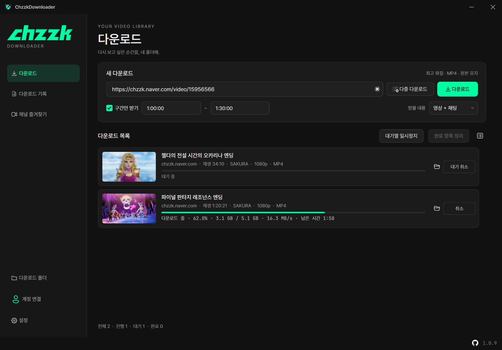 | 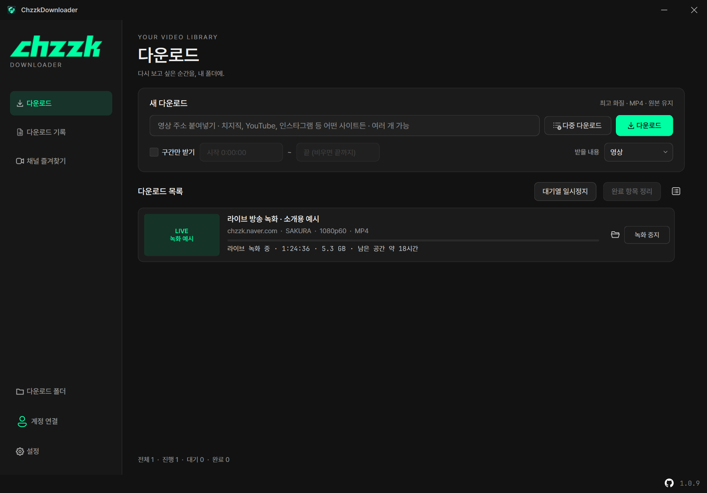 |

| 설정 | 채널 영상 |
| --- | --- |
| 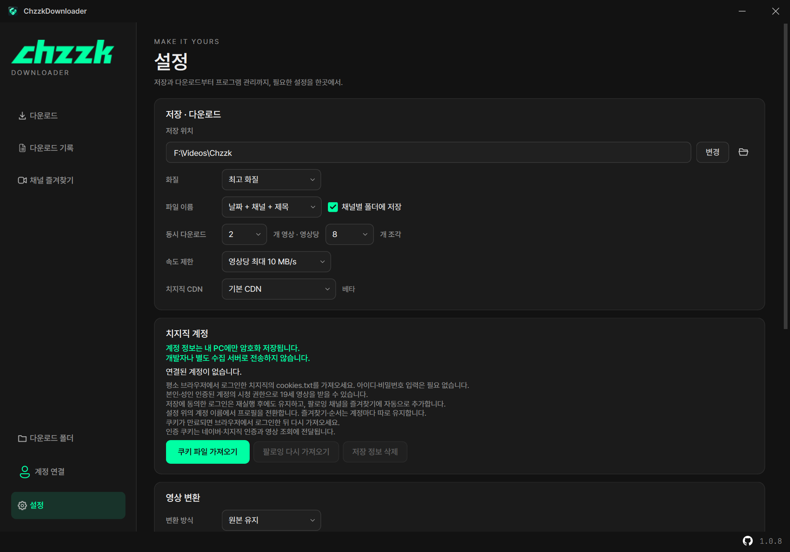 | 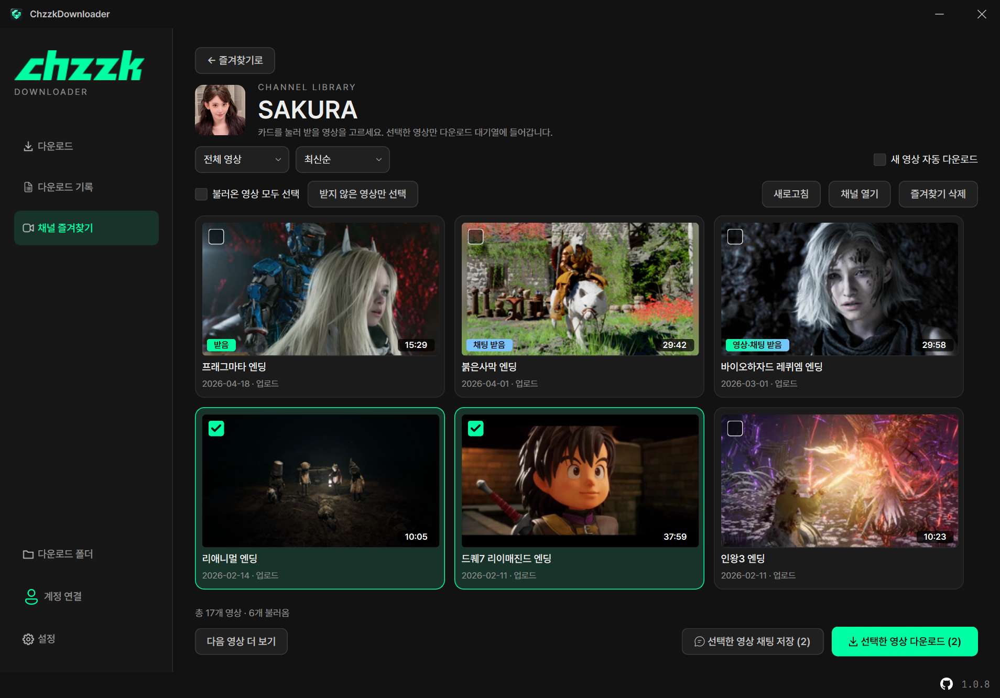 |

| 새 영상 확인·캐시 관리 | 채널 즐겨찾기 |
| --- | --- |
| 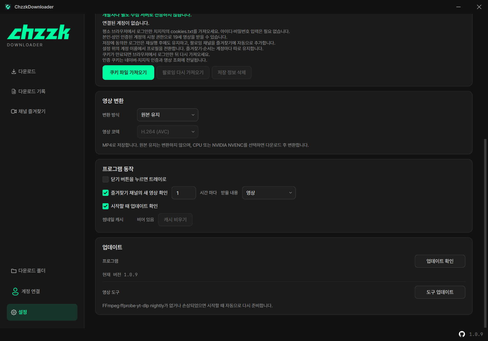 | 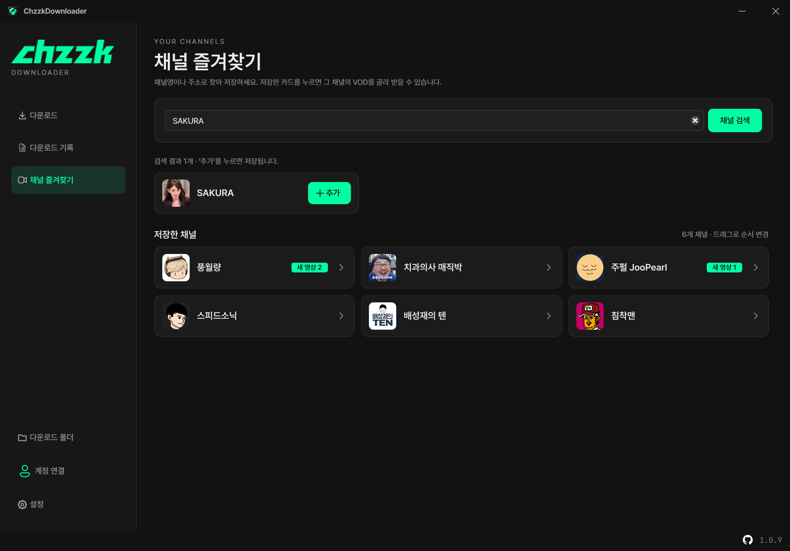 |

| 계정 전환 | 쿠키로 계정 연결 |
| --- | --- |
| 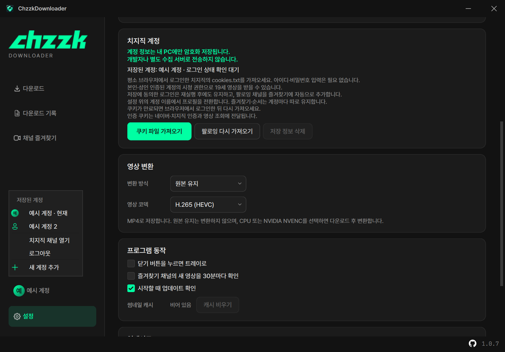 | 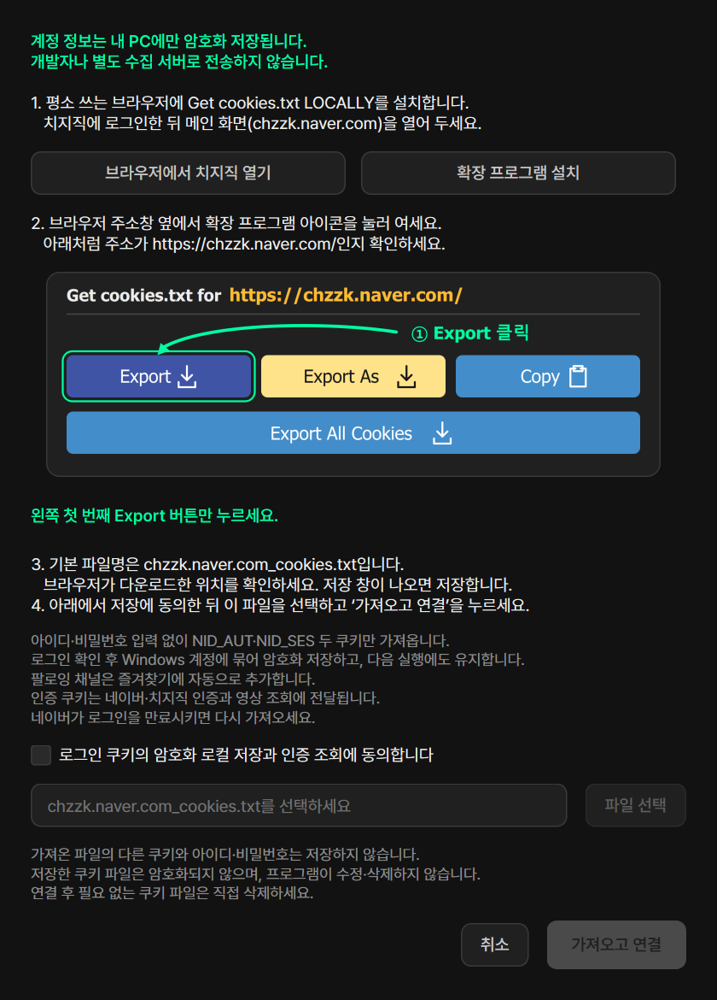 |

| 도구 준비 | 연령 제한 표시 |
| --- | --- |
| 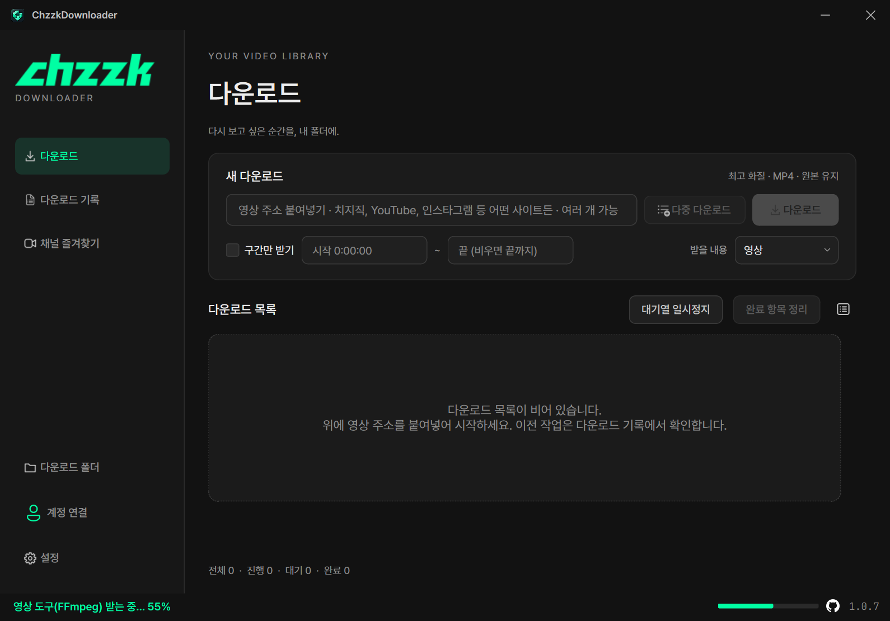 | 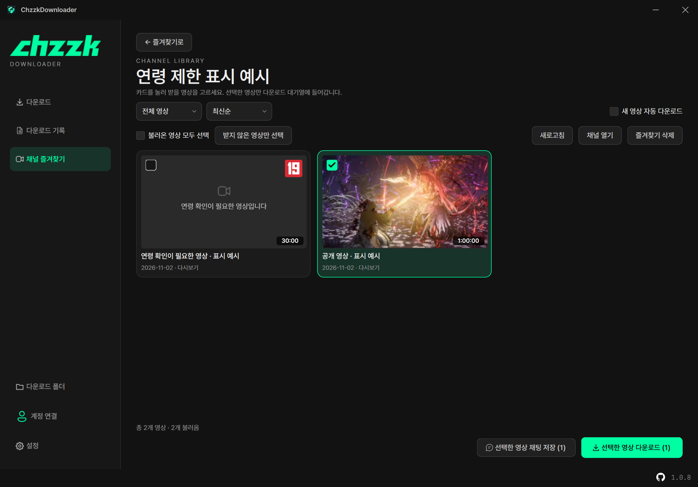 |

## ⚠️ 주의 사항

- 19세 영상은 본인·성인 인증된 네이버 계정으로 로그인해야 하며, 구독자 영상 등은 해당 계정의 시청 권한이 필요합니다. 인증·권한이 없는 영상은 받을 수 없습니다.
- **가져온 로그인 쿠키는 내 PC에만 암호화 저장하며, 개발자나 별도 수집 서버로 전송하지 않습니다.** 인증 쿠키는 네이버·치지직 인증과 영상 조회에 전달됩니다. 앱에서는 아이디·비밀번호를 입력받거나 저장하지 않습니다.
- 로그인 저장은 선택 사항입니다. 동의 후 가져온 로그인 쿠키는 `.auth`폴더에 Windows 사용자 계정에 묶여 암호화 저장됩니다. 앱 재실행 후에도 저장은 유지되지만 쿠키 만료나 네이버의 로그인 해제 시 다시 가져와야 하며, 영구 로그인을 보장하지 않습니다. 설정의 **저장 정보 삭제**로 지울 수 있습니다.
- **로그아웃·저장 정보 삭제**는 현재 계정의 쿠키만 지웁니다. 다른 저장 계정이 있으면 그 계정으로 전환하며, 즐겨찾기·영상은 유지합니다. 첫 연결 계정은 기존 공용 즐겨찾기를 이어받고, 이후 계정은 별도 목록을 사용합니다.
- 쿠키 파일 가져오기는 `NID_AUT`·`NID_SES`만 저장하며, 파일의 다른 쿠키와 경로는 저장하지 않습니다. 저장한 쿠키 파일은 암호화되지 않고 프로그램이 수정·삭제하지 않으므로 연결 후 필요 없는 쿠키 파일은 직접 삭제하세요.
- TVer 영상은 일본 VPN에 연결한 뒤 받아야 하며, 다운로드가 끝날 때까지 VPN 연결을 유지해야 합니다.
- 채팅 저장은 **치지직 다시보기만** 지원하며 라이브·클립·다른 사이트의 채팅은 받을 수 없습니다. 구독·후원·가림 상태는 저장하지만 팔로우 여부는 제공되지 않습니다. 19세·구독자 전용 다시보기의 채팅도 연결한 계정의 시청 권한이 필요합니다.
- 일반 영상의 저장 공간 확인은 크기를 알 수 있을 때만 동작합니다. 구간 다운로드는 앞뒤로 몇 초 차이가 날 수 있고 이어받기를 지원하지 않습니다.
- **라이브 녹화는 방송이 끝나거나 중지할 때까지 계속 저장하므로 저장 공간을 넉넉히 확보하세요.** 치지직 1080p60 기준 시간당 약 3.8GB가 쌓여 10시간이면 약 38GB가 필요하고, 녹화를 마친 뒤 MP4로 정리하는 동안 같은 크기의 공간이 잠시 더 필요합니다. 녹화 중에는 남은 공간으로 몇 시간을 더 녹화할 수 있는지 표시되며, 남은 공간이 1GB 아래로 줄면 녹화를 멈추고 지금까지 녹화한 부분을 저장합니다(MP4로 정리할 공간이 없으면 `.ts` 파일로 남습니다). 녹화는 주소를 넣은 시점부터 시작하므로, 방송 전체가 필요하면 방송이 끝난 뒤 다시보기를 받으세요.
- 창 크기는 화면과 Windows 배율에 맞춰 자동으로 정해집니다. 직접 크기를 조절하거나 최대화할 수 없으며, 작은 화면에서는 카드와 설정 내용을 스크롤로 볼 수 있습니다.
- 받은 영상은 **개인 소장 용도** 로만 사용하고, 저작권과 플랫폼 이용 약관을 지켜 주세요.
- 이 다운로더는 NAVER·치지직의 공식 프로그램이 아닙니다.

## 💾 설정 및 백업

EXE 옆의 `settings.json`(설정), `history.json`(다운로드 기록), `favorites.json`(채널 즐겨찾기)을 백업하세요. `thumbnail-cache\`는 지워도 다시 만들어집니다. 업데이트는 이 파일들을 바꾸지 않습니다.
계정을 연결했다면 `favorites-profiles\`(계정별 즐겨찾기) 폴더도 백업하세요. 계정에서 로그아웃해도 이 목록은 유지됩니다.
이미 받은 영상 표시·중복 확인을 유지하려면 `download-index.json`, 새 영상 확인·자동 다운로드 설정을 유지하려면 `channel-watch.json`도 함께 백업하세요. 중단된 영상을 이어받으려면 원래 저장 위치의 `.incomplete\` 폴더와 기록을 함께 보관해야 합니다.

로그인을 저장했다면 `.auth\naver-session.dat`도 같은 Windows 계정에서 유지할 수 있습니다. 다른 PC·Windows 계정에서는 이 파일을 쓸 수 없으므로 쿠키 파일을 다시 가져오세요. `.auth\runtime\`의 임시 쿠키는 백업하지 마세요.

## 🤝 문의 및 지원

- **버그 제보 및 기능 제안:** [GitHub Issues](https://github.com/deuxdoom/ChzzkDownloader/issues)
- **버전별 변경 내용:** [변경 기록](CHANGELOG.md) · [전체 릴리스](https://github.com/deuxdoom/ChzzkDownloader/releases)

## 📜 라이선스 및 저작권

**Copyright © 2026 SAKURA. All rights reserved.**

| 항목 | 내용 |
| --- | --- |
| 배포 형태 | 프리웨어 (개인·비상업적 사용) |
| 소스 코드 | 비공개 |

본 저장소는 **ChzzkDownloader의 배포 및 소개를 위한 공간**입니다. 프로젝트 자체 소스 코드는 공개하지 않으며, 프로그램과 자체 제작 자료에는 [프로젝트 이용 조건](LICENSE)이 적용됩니다.

- **개인 이용**: 개인의 비상업적 용도로 사용할 수 있습니다.
- **상업적 이용 금지**: 제작자의 사전 허락 없이 판매·유료 서비스 제공 등 영리 목적으로 이용할 수 없습니다.
- **무단 재배포 금지**: 제작자의 사전 허락 없이 프로그램·배포 파일·자체 제작 자료를 재업로드하거나, 수정한 버전을 배포할 수 없습니다. 소개할 때는 공식 홈페이지나 릴리스 링크를 공유해 주세요.

### 제3자 구성 요소

사용하는 FFmpeg·yt-dlp(첫 실행 때 받음)·PySide6·Pretendard·JetBrains Mono·아이콘(Fluent UI System Icons, Octicons) 등 외부 구성요소에는 각각의 라이선스가 적용되며, 위 제한은 해당 라이선스가 부여하는 권리를 제한하지 않습니다.
